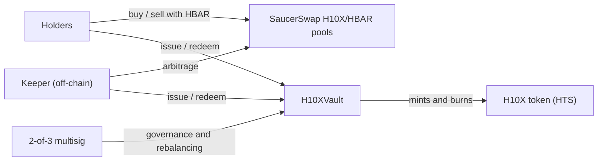
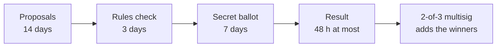

# H10X Index

[](https://github.com/burnbytes26/H10X-index/actions/workflows/test.yml)
[](LICENSE)

**The Hedera Index DTF.** H10X is an HTS token fully backed by a basket of Hedera ecosystem tokens (8 today, up to 10),
held 1:1 in an immutable on-chain vault. Anyone can issue H10X by depositing the basket and redeem it for the basket at
any time. The tokens are chosen by published rules, and holders vote on the tokens for the free slots.

This repository contains the vault contract that is live on Hedera mainnet, its full test suite, the security review,
the basket selection rules and DAO, and the backtest behind the index.

## Live on Hedera mainnet

Deployed and seeded on 6 October 2026.

| | ID | Notes |
|---|---|---|
| **H10X token** | [`0.0.10907484`](https://hashscan.io/mainnet/token/0.0.10907484) | H10X Index (H10X), 8 decimals. Its treasury and only supply key is the vault |
| **H10XVault 1.3.0** | [`0.0.10907483`](https://hashscan.io/mainnet/contract/0.0.10907483) | EVM `0x0000000000000000000000000000000000a66f5b`. Immutable, no admin key. Source verified on Sourcify (exact match) |
| **Governance** | [`0.0.10907480`](https://hashscan.io/mainnet/account/0.0.10907480) | 2-of-3 multisig: owner, guardian and rebalancer of the vault |
| **Website** | [h10xindex.xyz](https://h10xindex.xyz) | Live NAV, holdings, supply and DAO rounds |

## How it works



- **Issue.** Deposit the proportional basket and the vault mints H10X. The vault is the token's treasury and its only
  supply key, so H10X cannot be created any other way. Fee: 0.5%.
- **Redeem.** Burn H10X and receive your pro-rata share of every component. Redemption can never be paused. If a basket
  token is frozen or deleted by its issuer, the redeemer can skip it and still exit with everything else. Fee: 0.5%.
- **Rebalance.** Only the rebalancer role, only swaps between basket components through the SaucerSwap V1/V2 routers
  fixed at deployment. The output must return to the vault, a minimum output is mandatory, and each swap is capped to
  a share of the holding (20% at deployment).
- **Price.** The vault has no price oracle. The market price on SaucerSwap is kept close to the net asset value (NAV)
  by arbitrage between the pools and issue/redeem: above NAV it pays to issue and sell, below NAV it pays to buy and
  redeem. The team runs a keeper that does this around the clock; it holds no role in the vault.

### Basket (target weights)

8 tokens and 2 free slots for the next DAO votes.

| Token | Hedera token ID | Weight |
|---|---|---|
| HBAR (held as WHBAR) | [`0.0.1456986`](https://hashscan.io/mainnet/token/0.0.1456986) | 20% |
| Bitcoin (HTS-WBTC) | [`0.0.10082597`](https://hashscan.io/mainnet/token/0.0.10082597) | 20% |
| xSAUCE (staked SAUCE) | [`0.0.1460200`](https://hashscan.io/mainnet/token/0.0.1460200) | 15% |
| Ether (HTS-WETH) | [`0.0.9770617`](https://hashscan.io/mainnet/token/0.0.9770617) | 10% |
| DOVU | [`0.0.3716059`](https://hashscan.io/mainnet/token/0.0.3716059) | 10% |
| PACK (HashPack) | [`0.0.4794920`](https://hashscan.io/mainnet/token/0.0.4794920) | 10% |
| HBARX (Stader staked HBAR) | [`0.0.834116`](https://hashscan.io/mainnet/token/0.0.834116) | 10% |
| GIB | [`0.0.7893707`](https://hashscan.io/mainnet/token/0.0.7893707) | 5% |

The live composition can be read on-chain with `getBasket()`. Every change to the basket since launch is listed in
[GOVERNANCE.md](GOVERNANCE.md#changes-to-the-basket).

## Basket selection and the DAO

Tokens are chosen by published rules and reviewed every quarter. In short, a token needs a SaucerSwap pool against HBAR,
an issuer that can't block the vault, enough 90-day average liquidity and market cap for its weight, and at least 12
months of history. A new token must beat the minimums by 20%; a token leaves if it misses them at two reviews in a
row, or sooner after a serious event such as an exploit.

**Holders choose the tokens for the free slots.** Each quarter, a DAO round runs on a Hedera Consensus Service topic
with no admin key and no submit key, so nobody can delete or censor its messages:



- **Propose.** Holders with at least 500 H10X (also 7 days earlier) propose a token for a 10 H10X fee.
- **Rules check.** Only candidates that meet the selection rules reach the ballot. The team can only rule a candidate
  out, with the reason published.
- **Vote.** One vote per account, weighted by its H10X balance when voting opens (contracts such as the vault and the
  pools don't vote). Votes are encrypted in the browser with a [drand](https://drand.love) time lock, so nobody, the
  team included, can read them before the close.
- **Result.** With a 10% quorum, candidates with more votes than "leave the slot empty" win. The vault buys them before
  the result is published, and the round key comes out within 48 hours so anyone can repeat the count.

Full rules, thresholds and message formats: [GOVERNANCE.md](GOVERNANCE.md). Live rounds:
[h10xindex.xyz/#dao](https://h10xindex.xyz/#dao).

## What the team can and cannot do

| Cannot | Can (2-of-3 multisig only) |
|---|---|
| Mint H10X without the basket going in | Change target weights and components (max. 10) |
| Withdraw basket tokens: there is no withdrawal function, tokens only leave the vault when a holder redeems | Set fees, never above the 1% hard cap in the code |
| Pause redemptions | Pause new issuance (also the guardian), set a supply cap |
| Upgrade or replace the contract (no proxy, no admin key) | Run rebalancing swaps and choose their routes and minimum outputs |

The vault doesn't enforce the selection rules or the DAO's result: the multisig commits to following them, and every
change to the basket is public on-chain. Holders also trust the multisig with the quality of rebalancing (route and
minimum output). This is documented as finding F-1 in the security review. The signing page decodes every proposal,
shows each hop of a swap route and warns about unusual routes or low minimum outputs.

Checks enforced on-chain by the vault:

- **H10X token.** Before adopting it, the vault verifies that it is the treasury and the only supply key, and that
  the token has no admin, KYC, freeze, wipe, fee-schedule or pause keys and no custom fees.
- **Basket components.** A token can only join the basket if it has no KYC, freeze, fee-schedule or pause keys and
  no custom fees, so its issuer cannot block the vault's transfers or add fees later. On top of that, our basket rule
  only proposes a token with a wipe key if that key is held by a reviewed contract that can't burn the vault's balance.

## Security

- **128 Foundry tests**: unit, fuzz, invariant and economic simulations, with a mocked Hedera Token Service, plus the
  findings of the bug bounty (`test/H10XVault.bounty.t.sol`).
- **Static analysis**: Slither 0.11.6 and Aderyn 0.6.8. Every result was triaged by hand and no exploitable issue
  remains. Raw outputs are in [`security/`](security).
- **Manual review**: two rounds. Version 1.3.0 fixes every finding except F-1 (trust in the multisig, by design) and
  F-5 (a harmless dust case with a workaround).
- **Testnet**: the fixes were verified live on Hedera testnet, and 1.3.0 passed a full rehearsal before mainnet,
  including a basket token deleted by its issuer.
- **Bug bounty**: $2,000 in HBAR for a critical vulnerability, on Hedera testnet until 6 November 2026. No critical
  issue was found; every finding and what we did is in [`security/bug-bounty-2026-11.md`](security/bug-bounty-2026-11.md).

This is a self-review and a public bug bounty, **not an independent audit**. An independent audit is planned. Full report:
[`security/H10X-Security-Review-Public.pdf`](security/H10X-Security-Review-Public.pdf) and
[`security/static-analysis-2026-09-30.md`](security/static-analysis-2026-09-30.md).
To report a vulnerability, see [SECURITY.md](SECURITY.md).

## Build and test

Requirements: [Foundry](https://book.getfoundry.sh/getting-started/installation) and Node.js 18 or later (used only
to fetch the Solidity dependencies).

```bash
npm ci
forge build
forge test
```

The build is reproducible: compiling this repository with the settings in `foundry.toml` (solc 0.8.28, Cancun,
optimizer 200 runs) gives runtime bytecode identical to the contract verified on Sourcify for `0.0.10907483`
(23,882 bytes, metadata hash included).

## Repository layout

```
src/H10XVault.sol              the vault (identical to the verified mainnet source)
src/interfaces/ISaucerSwap.sol SaucerSwap V1/V2 router interfaces
test/                          Foundry tests, mocks for HTS and SaucerSwap
security/                      security review, bug bounty results, static-analysis report and raw Slither/Aderyn output
research/backtest/             3-year backtest of the current basket against BTC, HBAR and SAUCE
GOVERNANCE.md                  basket selection rules, the DAO and the history of basket changes
```

Operational tooling (deployment and governance scripts, the keeper, the data services behind the website and the DAO,
and server configuration) is kept private. The vault is the only on-chain contract of the protocol and it is published
here in full; the DAO's votes and results are public in its HCS topic.

## Backtest

$10,000 invested on 1 October 2023 in today's basket, with monthly rebalancing, would have grown to about $43,300,
against $30,200 in Bitcoin, $18,900 in HBAR and $8,400 in SAUCE alone, with high volatility (maximum drawdown −64.5%).
Hypothetical results, not a forecast. Method and data: [`research/backtest`](research/backtest) and the full report
at [h10xindex.xyz/backtest](https://h10xindex.xyz/backtest/).

## Disclaimer

H10X is a basket of volatile crypto assets. Nothing in this repository is investment advice. The contract has had a
self-review, not an independent audit. Use at your own risk.

## Contact

[h10xindex.xyz](https://h10xindex.xyz) · h10xindex@gmail.com

## License

[MIT](LICENSE)
