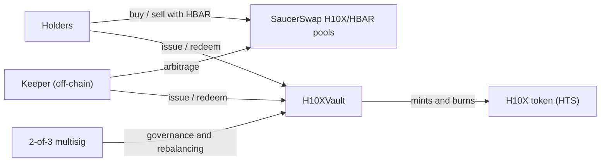

# H10X Index

[](https://github.com/burnbytes26/H10X-index/actions/workflows/test.yml)
[](LICENSE)

**The Hedera ecosystem in a single token.** H10X is an HTS token fully backed by a basket of 10 Hedera assets, held
in an immutable on-chain vault. Anyone can issue H10X by depositing the basket and redeem it for the basket at any time.

This repository contains the vault contract that is live on Hedera mainnet, its full test suite, the security review
and the backtest behind the index.

## Live on Hedera mainnet

Deployed and seeded on 6 October 2026.

| | ID | Notes |
|---|---|---|
| **H10X token** | [`0.0.10907484`](https://hashscan.io/mainnet/token/0.0.10907484) | H10X Index (H10X), 8 decimals. Its treasury and only supply key is the vault |
| **H10XVault 1.3.0** | [`0.0.10907483`](https://hashscan.io/mainnet/contract/0.0.10907483) | EVM `0x0000000000000000000000000000000000a66f5b`. Immutable, no admin key. Source verified on Sourcify (exact match) |
| **Governance** | [`0.0.10907480`](https://hashscan.io/mainnet/account/0.0.10907480) | 2-of-3 multisig: owner, guardian and rebalancer of the vault |
| **Website** | [h10xindex.xyz](https://h10xindex.xyz) | Live NAV, holdings and supply |

## How it works



- **Issue.** Deposit the proportional basket and the vault mints H10X. The vault is the token's treasury and its only
  supply key, so H10X cannot be created any other way. Fee: 0.5%.
- **Redeem.** Burn H10X and receive your pro-rata share of every component. Redemption can never be paused. If a basket
  token is frozen or deleted by its issuer, the redeemer can skip it and still exit with everything else. Fee: 0.5%.
- **Rebalance.** Only the rebalancer role, only swaps between basket components through the SaucerSwap V1/V2 routers
  fixed at deployment. The output must return to the vault, a minimum output is mandatory, and each swap is capped to
  a share of the holding (20% at deployment).
- **Price.** The vault has no price oracle. The market price on SaucerSwap is kept close to the net asset value (NAV)
  by arbitrage between the pools and issue/redeem: above NAV it pays to issue and sell, below NAV it pays to buy and
  redeem. The team runs a keeper that does this around the clock; it holds no role in the vault.

### Basket (target weights)

| Asset | Weight |
|---|---|
| HBAR | 20% |
| BTC (HTS-WBTC) | 15% |
| SAUCE · ETH · BONZO · DOVU · GIB | 10% each |
| PACK · DAVINCI · GRELF | 5% each |

The live composition can be read on-chain with `getBasket()`.

## What the team can and cannot do

| Cannot | Can (2-of-3 multisig only) |
|---|---|
| Mint H10X without the basket going in | Change target weights and components (max. 10) |
| Withdraw basket tokens: there is no withdrawal function, tokens only leave the vault when a holder redeems | Set fees, never above the 1% hard cap in the code |
| Pause redemptions | Pause new issuance (also the guardian), set a supply cap |
| Upgrade or replace the contract (no proxy, no admin key) | Run rebalancing swaps and choose their routes and minimum outputs |

Holders trust the multisig with the quality of rebalancing (route and minimum output). This is documented as
finding F-1 in the security review. The signing page decodes every proposal, shows each hop of a swap route and
warns about unusual routes or low minimum outputs.

Checks enforced on-chain by the vault:

- **H10X token.** Before adopting it, the vault verifies that it is the treasury and the only supply key, and that
  the token has no admin, KYC, freeze, wipe, fee-schedule or pause keys and no custom fees.
- **Basket components.** A token can only join the basket if it has no KYC, freeze, fee-schedule or pause keys and
  no custom fees, so its issuer cannot block the vault's transfers or add fees later.

## Security

- **124 Foundry tests**: unit, fuzz, invariant and economic simulations, with a mocked Hedera Token Service.
- **Static analysis**: Slither 0.11.6 and Aderyn 0.6.8. Every result was triaged by hand and no exploitable issue
  remains. Raw outputs are in [`security/`](security).
- **Manual review**: two rounds. Version 1.3.0 fixes every finding except F-1 (trust in the multisig, by design) and
  F-5 (a harmless dust case with a workaround).
- **Testnet**: the fixes were verified live on Hedera testnet, and 1.3.0 passed a full rehearsal before mainnet,
  including a basket token deleted by its issuer.

This is a self-review, **not an independent audit**. An independent audit is planned. Full report:
[`security/H10X-Security-Review-Public.pdf`](security/H10X-Security-Review-Public.pdf) and
[`security/static-analysis-2026-09-30.md`](security/static-analysis-2026-09-30.md).
To report a vulnerability, see [SECURITY.md](SECURITY.md).

## Build and test

Requirements: [Foundry](https://book.getfoundry.sh/getting-started/installation) and Node.js 18 or later (used only
to fetch the Solidity dependencies).

```bash
npm ci
forge build
forge test
```

The build is reproducible: compiling this repository with the settings in `foundry.toml` (solc 0.8.28, Cancun,
optimizer 200 runs) gives runtime bytecode identical to the contract verified on Sourcify for `0.0.10907483`
(23,882 bytes, metadata hash included).

## Repository layout

```
src/H10XVault.sol              the vault (identical to the verified mainnet source)
src/interfaces/ISaucerSwap.sol SaucerSwap V1/V2 router interfaces
test/                          Foundry tests, mocks for HTS and SaucerSwap
security/                      security review, static-analysis report and raw Slither/Aderyn output
research/backtest/             3-year backtest of the index against BTC and HBAR
```

Operational tooling (deployment and governance scripts, the keeper, the data service behind the website and server
configuration) is kept private. The vault is the only on-chain component of the protocol and it is published here in full.

## Backtest

$10,000 invested on 1 October 2023 with monthly rebalancing would have grown to about $47,500, against $30,200 in
Bitcoin and $18,900 in HBAR alone, with high volatility (maximum drawdown −66%). Hypothetical results, not a forecast.
Method and data: [`research/backtest`](research/backtest) and the full report at
[h10xindex.xyz/backtest](https://h10xindex.xyz/backtest/).

## Disclaimer

H10X is a basket of volatile crypto assets. Nothing in this repository is investment advice. The contract has had a
self-review, not an independent audit. Use at your own risk.

## Contact

[h10xindex.xyz](https://h10xindex.xyz) · h10xindex@gmail.com

## License

[MIT](LICENSE)
